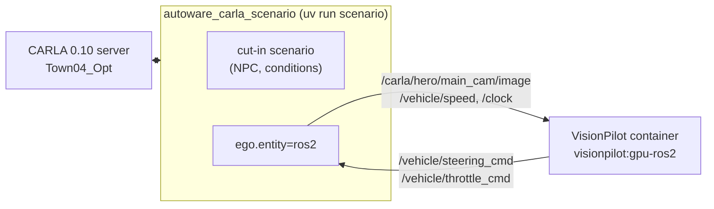

# VisionPilot ⇄ CARLA 0.10 under autoware_carla_scenario

The closed loop of [`../README.md`](../README.md), with
[autoware_carla_scenario](https://github.com/autowarefoundation/autoware_carla_scenario)
running the world: it spawns the ego and the scenario's other vehicles, and drives the
ego from ROS 2 topics (`ego.entity=ros2`, its `docs/ros2.md`). It takes the place of the
two CARLA-side nodes of the plain loop:

| Plain loop                                                                                          | Under autoware_carla_scenario                                                                                                                |
| --------------------------------------------------------------------------------------------------- | -------------------------------------------------------------------------------------------------------------------------------------------- |
| `carla_vehicle_speed_publisher`: `/vehicle/speed`                                                   | the framework publishes `/vehicle/speed`                                                                                                     |
| `carla_control_publisher`: `/vehicle/{steering,throttle}_cmd` → `/carla/hero/ackermann_control_cmd` | the framework reads `/vehicle/{steering,throttle}_cmd` (`steer_accel` source) and applies them to CARLA's Ackermann controller, the same way |
| camera and `/clock` from the server's `-ros2`                                                       | the same, or, for a server built without ROS 2, published by the framework (`ros2.cameras`, `ros2.clock_topic`)                              |

VisionPilot itself runs unchanged, in the `--gpu --ros2` image, on `rmw_cyclonedds_cpp`
(the framework speaks Cyclone DDS).



## Files

| File                          | What                                                                                                                                                                                             |
| ----------------------------- | ------------------------------------------------------------------------------------------------------------------------------------------------------------------------------------------------ |
| `conf/ros2/visionpilot.yaml`  | the framework's `ros2` group: the Lincoln MKZ of `../config/carla10.json`, its `main_cam` published as CARLA's own ROS 2 interface would, VisionPilot's `steer_accel` topics, real time at 20 Hz |
| `conf/map/town04_opt.yaml`    | the framework's `map` group for Town04_Opt (see below)                                                                                                                                           |
| `config/visionpilot.acs.conf` | `../config/visionpilot.carla.conf` with `speed_limit = 8.33` (the cut-in's 30 km/h)                                                                                                              |
| `cyclonedds.xml`              | loopback-only Cyclone DDS for both sides                                                                                                                                                         |
| `run_cut_in.sh`               | starts VisionPilot, then runs the cut-in                                                                                                                                                         |

## Running

1. A CARLA 0.10 server on Town04_Opt, with or without `-ros2`. For a UE 5.8 tree (the
   `run-carla-ue58-server` skill):

   ```bash
   DETACH=1 bash Skills/ue58/run-carla-ue58-server/scripts/run_server.sh game Town04_Opt
   ```

2. The VisionPilot image: `VisionPilot/docker/build.sh --gpu --ros2`.

3. An autoware_carla_scenario checkout with the `ros2` extra (`uv sync --dev`), at
   `ACS_DIR`. It needs autoware_carla_scenario 12.0 or later: `ros2.cameras` when the
   server has no ROS 2, and the vehicle-ahead gap measured bumper to bumper along
   the ego's lane, which places the NPC (`scenario.npc_gap_m`).

4. The Town04 map, once (below).

```bash
ACS_DIR=~/workspace/autoware_carla_scenario ./run_cut_in.sh
```

The framework writes its result, the trajectory and a chase-camera video to
`$ACS_DIR/outputs/<date>/<time>/`. VisionPilot's log is left in
`/tmp/visionpilot-acs-<domain>.log`.

### The Town04 map

autoware_carla_scenario places vehicles by Lanelet2 lanelet; no Autoware map of CARLA
0.10's Town04_Opt is published. CARLA's own map tools generate one from the server's
OpenDRIVE (`commonroad-scenario-designer`):

```bash
cd PythonAPI/examples/av_stacks/autoware/map_tools   # in the CARLA tree
python generate_map_artifacts.py --town Town04_Opt --no-load --skip-pointcloud \
    --out ~/autoware_data/maps/Town04_Opt
```

The lanelet ids in `run_cut_in.sh` are that map's. Its lanelets run for hundreds of
metres across several OpenDRIVE roads, and the outer lanes' are longer than the
inner ones', so a distance along one lanelet is not the same distance along its
neighbour:

- The ego starts on lanelet 79016 (the middle lane of Town04_Opt's spawn point 5) at
  s = 640 m, where the lane runs straight inside OpenDRIVE road 41. The scenario
  checks the cut-in against the ego's OpenDRIVE road and lane, so the whole
  manoeuvre has to stay on one road.
- The NPC starts on lanelet 77298, the lane to its left, with its rear bumper 8 m
  ahead of the ego's front one along the ego's lane (`scenario.npc_gap_m`). The
  framework places it with the ODD's own gap measure, so the outer lanelet being
  the longer needs no correction.

## A server built without ROS 2, and the CARLA client

A UE 5.8 tree configured without `-DENABLE_ROS2=ON` publishes nothing over ROS 2; the
framework then publishes the camera and `/clock` itself (`conf/ros2/visionpilot.yaml`).
On a server started with `-ros2`, set `ros2.cameras=[]` and `ros2.clock_topic=null`, or
both publish.

The framework's CARLA client (typesafe_carla) ships LibCarla built from `ue5-dev`.
Against a UE 5.8 (`ue58-dev`) server it crashes in `get_world()`: the RPC types have
moved on. Build its native library from the server's own tree and point
`TYPESAFE_CARLA_LIB` at it:

```bash
cmake -S typesafe_carla -B build-ue58 -DTSC_BACKEND=libcarla \
    -DTSC_CARLA_SOURCE_DIR=/path/to/carla-ue58 -DCMAKE_BUILD_TYPE=Release
cmake --build build-ue58 -j
export TYPESAFE_CARLA_LIB=$PWD/build-ue58/libtypesafe_carla_ffi.so
```
